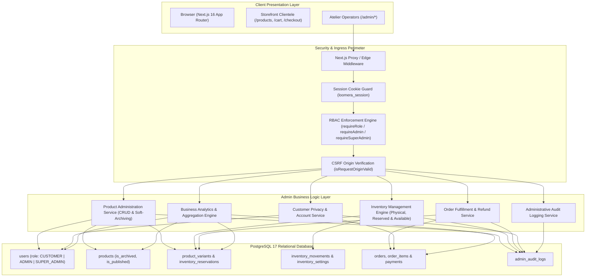

# LOOMERA — PHASE 5 ADMIN ARCHITECTURE SPECIFICATION
**Secure Role-Based Administration, Atelier Operations & Business Intelligence**
**Date:** November 3, 2026  
**Architect:** Principal Full-Stack Engineer & Database Architect  
**Project:** LOOMERA — High-End Menswear & Youth Atelier E-Commerce Platform

---

## 1. ARCHITECTURAL OVERVIEW

The LOOMERA Phase 5 Administration platform delivers a hardened, enterprise-grade back-office management console engineered specifically for luxury fashion operations. It unites real-time PostgreSQL transactional consistency, multi-tier Role-Based Access Control (RBAC), multi-state inventory management, and business analytics into a unified atelier interface.

---

## 2. ROLE-BASED ACCESS CONTROL (RBAC) MODEL

### 2.1 Role Hierarchy & Permissions Matrix

| Privilege Scope | `CUSTOMER` | `ADMIN` | `SUPER_ADMIN` |
| :--- | :---: | :---: | :---: |
| Storefront Catalog Browsing | ✅ | ✅ | ✅ |
| Persistent Cart & Wishlist | ✅ | ✅ | ✅ |
| Personal Order History (`/orders`) | ✅ | ✅ | ✅ |
| Cancel Own Pending/Confirmed Order | ✅ | ✅ | ✅ |
| Atelier Dashboard Overview (`/admin`) | ❌ | ✅ | ✅ |
| Product Catalog Management (`/admin/products`) | ❌ | ✅ | ✅ |
| Soft-Archive / Restore Garments | ❌ | ✅ | ✅ |
| Hard-Delete Products (Zero-Order Check) | ❌ | ✅ | ✅ |
| Inventory Adjustment Matrix (`/admin/inventory`) | ❌ | ✅ | ✅ |
| Order Dossier Inspection & Status Transition | ❌ | ✅ | ✅ |
| Process Order Refunds & Restock Returns | ❌ | ✅ | ✅ |
| View Business Analytics & KPIs (`/admin/analytics`) | ❌ | ✅ | ✅ |
| View Administrative Audit Ledger (`/admin/audit-logs`)| ❌ | ✅ | ✅ |
| Alter Patron Roles (`/api/admin/customers/[id]`) | ❌ | ❌ | ✅ |
| Modify Master Low-Stock Thresholds | ❌ | ✅ | ✅ |

### 2.2 Security Implementation (`src/lib/auth/rbac.ts`)
* **Strict Session Validation:** Resolves high-entropy session token from `loomera_session` cookie, verifies SHA-256 hash in PostgreSQL `sessions` table, checks sliding TTL expiration, and extracts authenticated `user.role`.
* **Zero Self-Escalation:** The public registration endpoint (`/api/auth/register`) strictly sets `role = 'CUSTOMER'` and rejects any client-supplied `role` parameter.
* **Super Admin Demotion Prevention:** Super administrators cannot demote their own account, preventing accidental organizational lockouts.
* **Defense in Depth:** Dual-layer verification:
  1. *Perimeter Guard:* Next.js Edge Middleware intercepts `/admin/:path*` and redirects unauthenticated traffic to `/login?redirect=/admin`.
  2. *Server Component Layout Guard:* `src/app/admin/layout.tsx` validates session authenticity and renders an access-denied screen if `user.role === 'CUSTOMER'`.
  3. *API Route Handler Guard:* Every `/api/admin/*` route invokes `await requireAdmin(req)` or `await requireSuperAdmin(req)` before parsing request payloads.

---

## 3. ADMIN APPLICATION ROUTE MAP

### 3.1 Frontend Web Interfaces (`src/app/admin/`)
* **`/admin` (Overview Dashboard):** Real-time KPI summary (Gross Revenue, Net Revenue, Total Orders, Inventory Valuation, Low-Stock SKUs), daily sales velocity chart, and best-selling garments leaderboard.
* **`/admin/products` (Catalog Management):** Responsive data table, fuzzy search, category filter, soft-archive toggle, and modal drawer to create bespoke garments with initial variant matrix.
* **`/admin/inventory` (Warehouse & Supply):** Tabbed interface with Live Inventory Matrix (physical stock, active reservations, effective available stock, low-stock chips) and Historical Movement Ledger. Includes threshold adjustment control and transactional stock adjustment modal.
* **`/admin/orders` (Fulfillment & Returns):** Order list with search by order number, patron name, phone, or email. Order Inspector drawer displaying line-item price snapshots, delivery addresses, payment verification, status transition dropdown, and refund trigger.
* **`/admin/customers` (Patron Directory):** Directory displaying customer lifetime spend, total orders placed, and account creation dates. Includes role promotion controls for Super Administrators.
* **`/admin/analytics` (Business Intelligence):** In-depth revenue analytics, customizable lookback windows (7, 14, 30, 90 days), daily revenue charts, top product revenue ranking, and category performance breakdown.
* **`/admin/audit-logs` (Security & Governance):** Chronological audit trail showing operator email, timestamp, action type, resource target, IP address, and JSON diffs of state changes.

### 3.2 Secure Administrative REST APIs (`src/app/api/admin/`)
* `GET /api/admin/analytics`: Aggregated executive metrics and sales timelines.
* `GET, POST /api/admin/products`: Product listing with filters; product creation with variants and photography.
* `GET, PUT, DELETE /api/admin/products/[id]`: Product retrieval, attribute updates, and safe deletion with archive fallback.
* `POST /api/admin/products/[id]/archive`: Dedicated soft-archive / restore toggle.
* `POST /api/admin/products/[id]/variants`: Variant matrix addition.
* `PUT /api/admin/products/[id]/images`: Photography replacement and display order resequencing.
* `PUT, DELETE /api/admin/variants/[id]`: Variant attribute updates and safe deletion.
* `GET, POST /api/admin/inventory`: Live stock overview; transactional stock adjustment (`STOCK_ADDED`, `STOCK_REMOVED`, `STOCK_ADJUSTED`, `DAMAGED_STOCK`, `RETURN_RECEIVED`).
* `GET /api/admin/inventory/movements`: Historical inventory movement ledger.
* `GET, PUT /api/admin/inventory/settings`: Low-stock threshold retrieval and configuration.
* `GET /api/admin/orders`: Order search and status filtering.
* `GET, PATCH /api/admin/orders/[id]`: Order detail inspection and fulfillment status transitions.
* `POST /api/admin/orders/[id]/refund`: Administrative refund processing with optional stock restoration.
* `GET /api/admin/customers`: Patron directory with lifetime spend metrics.
* `GET, PATCH /api/admin/customers/[id]`: Customer dossier retrieval and Super Admin role updates.
* `GET /api/admin/audit-logs`: Audit trail querying with action and resource filters.

---

## 4. DESIGN SYSTEM & USER EXPERIENCE SPECIFICATION

The Admin Dashboard is built to match LOOMERA's luxury atelier aesthetic:
* **Palette:**
  * Deep Atelier Slate: `#1A333B` / `#264653` (Sidebar, primary buttons, headers)
  * Atelier Sage: `#2A9D8F` (KPI accents, status indicators, active tabs)
  * Terracotta Coral: `#E76F51` (Brand accents, high-priority notifications)
  * Alabaster Background: `#F4F1EB` / `#FAF8F5` (Warm, textured luxury paper feel)
* **Typography:**
  * Serif Headlines: Playfair Display / Cormorant Garamond aesthetic for royal elegance
  * Sans-Serif Body: Clean, accessible interface typography for high-density administrative tables
  * Monospace Numerics: JetBrains Mono / SF Mono for order numbers, SKUs, and currency amounts
* **Mobile Responsiveness:** Collapsible slide-out navigation drawer with touch backdrop for mobile floor managers and atelier staff on tablets.
