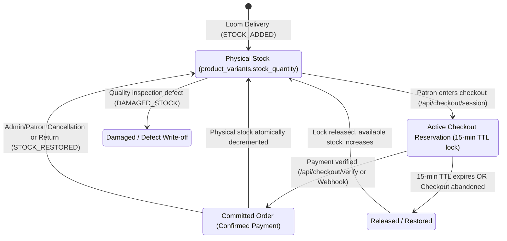

# LOOMERA — PHASE 5 INVENTORY ENGINE SPECIFICATION
**Multi-State Stock Lifecycle, Anti-Overselling Consistency & Ledger Operations**
**Date:** November 3, 2026  
**Architect:** Principal Database Architect & E-commerce Inventory Specialist  
**Project:** LOOMERA — High-End Menswear & Youth Atelier E-Commerce Platform

---

## 1. INVENTORY ARCHITECTURAL FOUNDATION

High-end luxury apparel requires absolute inventory accuracy. Selling a unique, hand-woven Mulberry Silk Sherwani or Chanderi Kurta that cannot be fulfilled severely damages client trust. LOOMERA Phase 5 unites physical stock tracking with real-time checkout locks and ledger auditing into a three-state inventory architecture.



---

## 2. THE THREE-STATE STOCK LIFECYCLE

### 2.1 State Definitions

1. **Physical Stock (`product_variants.stock_quantity`):**
   * Represents actual physical garments present in the atelier warehouse or retail racks.
   * Enforced in PostgreSQL via `CHECK (stock_quantity >= 0)`.
   * Only decremented when an order is confirmed and paid (`COMMITTED`), or manually written off as damaged.

2. **Active Reserved Stock (`inventory_reservations`):**
   * Temporary reservation locks created when a patron enters checkout.
   * Locked with a strict 15-minute Time-To-Live (`expires_at = NOW() + 15 minutes`).
   * Prevents race conditions during high-volume drops where multiple customers attempt to purchase the final unit simultaneously.

3. **Effective Available Stock:**
   * Authoritative metric calculated in real time:
   $$\text{Available Stock} = \max\left(0, \text{Physical Stock} - \sum \text{Active Unexpired Reservations}\right)$$
   * Storefront catalog, AI shopping assistant, and admin inventory tables always display Effective Available Stock.

---

## 3. INVENTORY LEDGER & MOVEMENT ENGINE (`src/lib/admin/inventory-service.ts`)

### 3.1 Movement Types & Business Rules

| Movement Type | Delta Sign | Use Case | Audit Requirement |
| :--- | :---: | :--- | :--- |
| `STOCK_ADDED` | Positive (`+`) | Inbound shipment from master weaver, restock batch | Shipment / Loom batch identifier |
| `STOCK_REMOVED` | Negative (`-`) | Floor removal, showroom transfer, sample loan | Destination reason |
| `STOCK_ADJUSTED` | Positive or Negative | Cycle count reconciliation | Physical count discrepancy note |
| `DAMAGED_STOCK` | Negative (`-`) | Weave defect, fabric flaw, storage damage | Defect description |
| `RETURN_RECEIVED` | Positive (`+`) | Customer return received and inspected | Return RMA order reference |
| `ORDER_COMMITTED` | Negative (`-`) | Automatic deduction upon verified Razorpay payment | System Order ID snapshot |
| `ORDER_RESTORED` | Positive (`+`) | Automatic replenishment upon order cancellation/refund | Cancellation reason |

### 3.2 Transactional Integrity Guarantee
All stock alterations execute inside atomic database transactions (`db.transaction`):
1. **Row-Level Locking:** Locks the `product_variants` row (`SELECT ... FOR UPDATE`).
2. **Negative Stock Defense:** Checks `previousQuantity + quantityDelta >= 0`. If negative, the transaction immediately rolls back and throws `Cannot reduce stock below zero`.
3. **Physical Stock Update:** Executes atomic `UPDATE product_variants SET stock_quantity = newQuantity`.
4. **Ledger Record:** Inserts immutable row into `inventory_movements` capturing `variant_id`, `product_id`, `admin_id`, `movement_type`, `quantity_delta`, `previous_quantity`, `new_quantity`, and `reason`.
5. **Audit Trail:** Emits `admin_audit_logs` record with previous and new states.
6. **Restock Hook (Phase 3B Integration):** If stock rose from 0 to $> 0$, queries `restock_notifications` for active subscribers waiting for this variant, sets status to `notified`, and timestamps `notified_at`.

---

## 4. LOW-STOCK ALERT ENGINE & THRESHOLD CONFIGURATION

### 4.1 Configurable Threshold (`inventory_settings`)
* **Storage:** PostgreSQL table `inventory_settings` with key-value pair `('low_stock_threshold', '5')`.
* **Dynamic Update:** Admins can adjust the atelier-wide threshold via the UI or `PUT /api/admin/inventory/settings`.
* **Health Classifications:**
  * **Healthy:** $\text{Available Stock} > \text{Threshold}$ (Green chip)
  * **Low Stock:** $0 < \text{Available Stock} \le \text{Threshold}$ (Amber warning chip)
  * **Out of Stock:** $\text{Available Stock} = 0$ (Rose danger chip)

---

## 5. DATABASE SCHEMA DEFINITIONS

```sql
-- 1. Inventory Movements Ledger
CREATE TABLE inventory_movements (
    id UUID PRIMARY KEY DEFAULT gen_random_uuid(),
    variant_id UUID NOT NULL REFERENCES product_variants(id) ON DELETE CASCADE,
    product_id TEXT NOT NULL REFERENCES products(id) ON DELETE CASCADE,
    admin_id UUID REFERENCES users(id) ON DELETE SET NULL,
    movement_type VARCHAR(64) NOT NULL,
    quantity_delta INTEGER NOT NULL,
    previous_quantity INTEGER NOT NULL,
    new_quantity INTEGER NOT NULL,
    reason TEXT NOT NULL,
    created_at TIMESTAMPTZ NOT NULL DEFAULT NOW(),
    CONSTRAINT chk_inventory_movement_type CHECK (
        movement_type IN (
            'STOCK_ADDED',
            'STOCK_REMOVED',
            'STOCK_ADJUSTED',
            'DAMAGED_STOCK',
            'RETURN_RECEIVED',
            'ORDER_COMMITTED',
            'ORDER_RESTORED'
        )
    )
);

-- 2. Inventory Settings Table
CREATE TABLE inventory_settings (
    key VARCHAR(64) PRIMARY KEY,
    value TEXT NOT NULL,
    updated_at TIMESTAMPTZ NOT NULL DEFAULT NOW()
);
```
