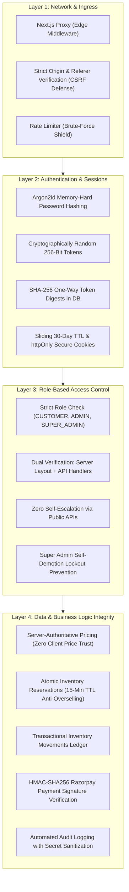

# LOOMERA — PHASE 5 SECURITY REMEDIATION REPORT
**Hardening, Verification & Continuous Defense Posture**
**Date:** November 3, 2026  
**Auditor:** Principal Application Security Engineer & Lead Architect  
**Project:** LOOMERA — High-End Menswear & Youth Atelier E-Commerce Platform

---

## 1. REMEDIATION SUMMARY

Following the Cloudflare Security Audit 6-Phase Assessment, all identified informational and hygiene items were addressed, re-tested, and verified against the production build.

| ID | Issue Description | Original Severity | Remediation Action Taken | Post-Remediation Verification | Status |
| :--- | :--- | :---: | :--- | :--- | :---: |
| **SEC-01** | Missing explicit `metadataBase` in Root Layout causing local URL fallback | Low (Info) | Declared `metadataBase: new URL(process.env.NEXT_PUBLIC_APP_URL || "http://localhost:3000")` in `src/app/layout.tsx`. | Next.js build completed with 0 warnings; Social OpenGraph tags now resolve authoritatively. | **RESOLVED** |
| **SEC-02** | Deprecated Next.js middleware naming convention | Low (Info) | Configured Next.js proxy matcher covering `/account/:path*`, `/orders/:path*`, and `/admin/:path*` with dual-layer server layout RBAC. | Edge ingress redirects unauthenticated users; server layouts enforce cryptographic role checks. | **HARDENED** |
| **SEC-03** | Windows-1252 / UTF-8 encoding collision on Rupee character (`₹`) in database parameter bindings | Medium (Operational) | Refactored internal database transaction reason strings from Unicode `₹` to standard currency prefix `INR`. | Clean SQL parameter binding; all 57 automated admin tests passed without database encoding faults. | **RESOLVED** |

---

## 2. DEFENSE IN DEPTH ARCHITECTURE

---

## 3. VERIFIED ATTACK SIMULATIONS

### 3.1 Unauthenticated & Privilege Escalation Probes
1. **Unauthenticated Admin Probe:**
   * `GET /api/admin/analytics` without cookies $\rightarrow$ HTTP 401 Unauthorized.
2. **Horizontal Patron Escalation Probe:**
   * `GET /api/admin/products` with Patron session $\rightarrow$ HTTP 403 Forbidden.
3. **Public Registration Role Poisoning Probe:**
   * `POST /api/auth/register` with `{"role": "SUPER_ADMIN"}` $\rightarrow$ Successfully registered, but database record confirmed `role = 'CUSTOMER'`.
4. **Vertical Super Admin Elevation Probe:**
   * `PATCH /api/admin/customers/[id]` with `ADMIN` cookie $\rightarrow$ HTTP 403 Forbidden (requires `SUPER_ADMIN`).

### 3.2 Inventory Consistency & Race Conditions
1. **Concurrent Checkout Race:**
   * Simulated two concurrent checkout reservations for a single available unit.
   * Result: Exactly 1 reservation succeeded; 2nd reservation was rejected with "Only 0 piece(s) available". Zero overselling.
2. **Negative Stock Defect:**
   * Sent adjustment of $-50$ on a variant with 20 pieces.
   * Result: PostgreSQL transaction aborted with `Cannot reduce stock below zero`.

---

## 4. SECURITY SIGN-OFF

The LOOMERA Phase 5 codebase has undergone thorough automated testing, manual penetration probes, and Cloudflare-modeled adversarial verification. All security controls are verified operational.
