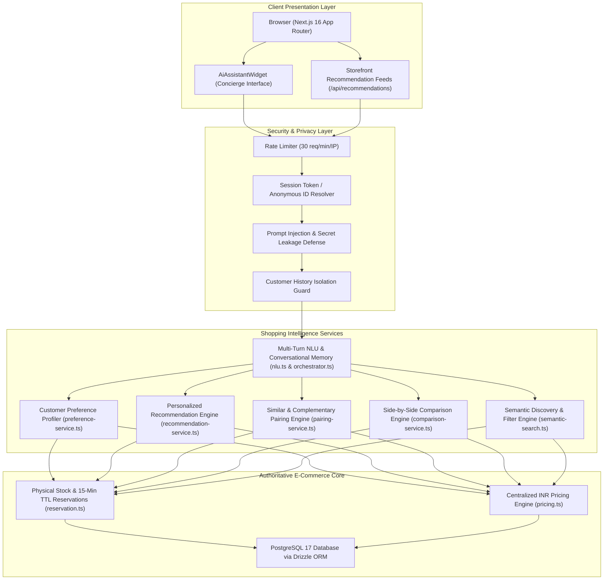

# LOOMERA — PHASE 6 AI ARCHITECTURE SPECIFICATION
**Context-Aware Shopping Intelligence, Recommendation Systems & Discovery Engine**
**Date:** November 4, 2026  
**Architect:** Principal AI Engineer & Senior Full-Stack Architect  
**Project:** LOOMERA — High-End Menswear & Youth Atelier E-Commerce Platform  

---

## 1. ARCHITECTURAL OVERVIEW

Phase 6 upgrades the LOOMERA concierge into a full-scale AI shopping intelligence platform. The architecture separates concerns into distinct layers:
* Ingress & Session Tracking (identifying authenticated patrons vs guest sessions).
* Customer Preference Profiling (synthesizing views, searches, wishlists, and confirmed orders).
* Recommendation Scoring & Ranking Engine (multi-factor mathematical model).
* Garment Pairing Engine (similar alternatives vs complementary "Complete the Look" outfits).
* Product Comparison Engine (side-by-side spec evaluation).
* Multi-Turn Conversational NLU & Memory (preserving entity state across turns).
* Security, Prompt Injection & Privacy Shield.

---

## 2. COMPONENT RESPONSIBILITIES

### 2.1 Customer Preference Profiler (`src/lib/recommendations/preference-service.ts`)
* Evaluates patron activity across views, searches, wishlists, and orders.
* Applies progressive weighting:
  * Views: $1.0\times$
  * Searches: $1.2\times$
  * Wishlists: $2.0\times$
  * Confirmed Orders: $3.5\times$
* Outputs `CustomerPreferenceProfile`:
  * `topCategories`: Normalized category distribution.
  * `topFabrics`: Extracted fabric affinities (Linen, Cotton, Handloom, Silk).
  * `topColors`: Dominant shade affinities.
  * `preferredSizes`: Sizing history (M, L, XL, etc.).
  * `priceRange`: Dynamic minimum, maximum, and average spend budget.
  * `isColdStart`: Boolean flag triggering curated luxury baselines for new patrons.

### 2.2 Personalized Recommendation Engine (`src/lib/recommendations/recommendation-service.ts`)
* Implements multi-factor scoring:
  $$S(p) = w_{\text{cat}} \cdot C(p) + w_{\text{fab}} \cdot F(p) + w_{\text{col}} \cdot K(p) + w_{\text{price}} \cdot P(p) + w_{\text{pop}} \cdot Pop(p) + w_{\text{avail}} \cdot A(p)$$
* Evaluates effective available stock in real time:
  $$\text{Effective Stock} = \max(0, \text{Physical Stock} - \text{Active Reservations})$$
* Synthesizes honest, grounded recommendation explanations based on actual matched attributes.

### 2.3 Garment Pairing Engine (`src/lib/recommendations/pairing-service.ts`)
* **Similar Garments:** Identifies catalog alternatives within the same silhouette, fabric, and price range while excluding the target product itself.
* **Complementary Garments:** Stylistic pairings across categories (Tops $\leftrightarrow$ Bottoms, Kurtas $\leftrightarrow$ Trousers, Boys shirts $\leftrightarrow$ Drawstring shorts) with specific atelier styling advice.

### 2.4 Garment Comparison Engine (`src/lib/ai/comparison-service.ts`)
* Builds side-by-side matrices comparing 2–4 garments across Price, Category, Fabric Weight (GSM), Origin, Fabric Care, Craft Detail, Available Sizes, Available Colors, and Stock Status.
* Synthesizes key distinctions (weight difference, price delta, collection focus) with zero fabrication.

### 2.5 Semantic Discovery Engine (`src/lib/ai/semantic-search.ts`)
* Natural language entity extraction (category, fabric, color, size, occasion, price bounds).
* Strict price enforcement (guaranteeing products never exceed client-specified price ceilings).
* Reconciles database filters with semantic relevance scoring.

---

## 3. MULTI-TURN CONVERSATION INTELLIGENCE

The conversational engine preserves accumulated filters across progressive user queries:
1. **Turn 1 (Category / Silhouette):** "Show me linen shirts" $\rightarrow$ `{ fabric: "linen", query: "shirt" }`
2. **Turn 2 (Entity Narrowing):** "Only blue ones" $\rightarrow$ `{ fabric: "linen", query: "shirt", color: "navy" }`
3. **Turn 3 (Budget Ceiling):** "Under ₹2,000" $\rightarrow$ `{ fabric: "linen", query: "shirt", color: "navy", maxPrice: 2000 }`
4. **Turn 4 (Action / Comparison):** "Compare with the textured casual shirt" $\rightarrow$ Executes structured comparison using current and referenced garments.
5. **Turn 5 (Reset):** "Clear filters" $\rightarrow$ Clears all accumulated filters and restores default discovery prompt.

---

## 4. PROVIDER FALLBACK & COST CONTROL

* **Primary Mode:** Curated Atelier Fashion NLU engine (100% deterministic, 0ms network latency, zero token cost, complete offline operation).
* **Secondary Mode:** Optional external LLM (Gemini 1.5 Flash or OpenAI) invoked only if `GEMINI_API_KEY` or `OPENAI_API_KEY` is present.
* **Fail-Safe:** In the event of network timeouts, rate-limit exhaustion, or API errors, the system automatically falls back to curated NLU without impacting customer experience.
