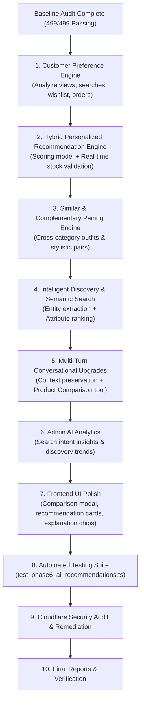

# LOOMERA — PHASE 6 INITIAL PROJECT AUDIT
**Advanced AI Shopping Intelligence, Personalization, Recommendations & Intelligent Product Discovery**
**Date:** November 4, 2026  
**Auditor:** Principal AI Engineer, Senior Full-Stack Architect & Application Security Engineer  
**Project:** LOOMERA — High-End Menswear & Youth Atelier E-Commerce Platform  

---

## 1. EXECUTIVE SUMMARY & BASELINE HEALTH AUDIT

Prior to designing and implementing Phase 6, an exhaustive baseline audit of the LOOMERA codebase was conducted with zero source modifications.

### 1.1 Automated Quality Pipeline Verification

All verification checks were executed against the active repository and live PostgreSQL 17 cluster (port 5434):

| Verification Suite | Command Executed | Result | Details |
| :--- | :--- | :---: | :--- |
| **Comprehensive Test Suite** | `npm test` | **PASSED (499/499 assertions, 100%)** | All 7 test suites (Pricing, DB, Phase 2 Auth/Cart, Phase 3A Assistant, Phase 3B Intelligence, Phase 4 Checkout, Phase 5 Admin) passed. |
| **ESLint Static Analysis** | `npm run lint` | **PASSED (0 errors, 0 warnings)** | Clean static analysis across all TypeScript source files. |
| **TypeScript Typecheck** | `npx tsc --noEmit` | **PASSED (0 type errors)** | Full type safety across Next.js 16 App Router, Drizzle models, and API endpoints. |
| **Production Build** | `npm run build` | **PASSED (45 routes compiled)** | Turbopack compilation succeeded; all static and dynamic routes bundled successfully. |

### 1.2 Active Database & Infrastructure State
* **PostgreSQL 17 Daemon:** Running on port `5434` with 24 relational tables in `.dev-db`.
* **Runtime:** Next.js 16.4.2 App Router with React 19, TypeScript, Tailwind CSS.
* **Auth & Session Infrastructure:** Argon2id hashing, 256-bit cryptographically secure sessions with sliding 30-day TTL in `sessions` table.
* **E-Commerce Foundation:** Centralized INR pricing engine, 15-minute TTL inventory reservations, Razorpay sandbox checkout, order state machine, soft-archiving catalog management, and administrative audit logs.

---

## 2. EXISTING AI & INTELLIGENCE ASSETS AUDIT

### 2.1 Existing AI Assistant Architecture (`src/lib/ai/`)
1. **`orchestrator.ts`:**
   * Main entry point for query processing.
   * `tryLlmOrchestration`: Supports optional external Gemini API (`GEMINI_API_KEY`) or OpenAI API (`OPENAI_API_KEY`).
   * Fallback engine: Curated fashion Natural-Language Understanding (NLU) mode that operates 100% locally with zero external network dependency.
   * Tool execution router for availability, view history, search history, restock info, and product search.
2. **`nlu.ts`:**
   * Intent parser identifying `search`, `details`, `collection`, `similar`, `filters`, `shipping_info`, `greeting`, `reset`, `availability`, `view_history`, `search_history`, `repeat_search`, `restock_info`, `restock_notify`.
   * Rule-based entity extraction for categories, colors, sizes, fabrics, price thresholds, and known product aliases.
   * Template-based conversational response builder with suggestion chips.
3. **`tools.ts`:**
   * Authoritative product search via Drizzle ORM (`searchProducts`).
   * Single product lookup (`getProductDetails`).
   * Collection listing (`getCollectionProducts`).
   * Rudimentary similarity lookup (`getSimilarProducts` based on simple category, price differential, and basic keyword match).
   * Inventory checks (`checkProductAvailabilityTool`, `getAvailableSizesTool`, `getAvailableColorsTool`).
   * History access (`getRecentlyViewedTool`, `getSearchHistoryTool`).
   * Restock tools (`getRestockInformationTool`).
4. **`rate-limit.ts`:**
   * In-memory sliding-window IP rate limiter allowing 30 requests per minute per IP.
5. **`AiAssistantWidget.tsx`:**
   * Floating interactive concierge widget styled with LOOMERA's luxury brand palette.
   * Features suggestion pills, live product cards with availability badges, and error state handling.

### 2.2 Customer Data Available for Personalization
The PostgreSQL database currently contains rich behavioral signals across 6 dedicated tables:
* `product_view_history`: User ID, session ID, product ID, timestamp.
* `search_history`: User ID, session ID, search query string, JSON filters, timestamp.
* `wishlists` & `wishlist_items`: User ID, product ID, added timestamp.
* `carts` & `cart_items`: User ID, product ID, size, color, quantity.
* `orders` & `order_items`: Confirmed and delivered garments, sizes, colors, price paid, order dates.
* `product_variants`: Exact size-level and color-level inventory quantities and reservation locks.

---

## 3. GAP ANALYSIS & LIMITATIONS

### 3.1 Gap 1: Lack of a Dedicated Customer Preference Profile Engine
* **Current State:** Browsing and search history exist as raw event logs, but there is no service to synthesize these into a structured patron preference profile (e.g. favorite fabrics, dominant color affinities, typical sizing, budget distribution, category affinities).
* **Impact:** Recommendations cannot weight customer-specific affinities against general catalog popularity.

### 3.2 Gap 2: Elementary Recommendation & Similarity Logic
* **Current State:** `getSimilarProducts` only checks same category and three hardcoded keywords ("linen", "cotton", "handloom").
* **Impact:**
  * No multi-factor scoring (no weight for style, price compatibility, customer preference match, or popularity).
  * No concept of **Complementary Products** (e.g., matching a linen shirt with complementary linen trousers or kurtas with formal bottoms).
  * No personalized recommendation feed for authenticated patrons.

### 3.3 Gap 3: Missing Recommendation Explanations
* **Current State:** When products are returned, there is no explanation of *why* the product was recommended.
* **Impact:** Lacks the personal touch of a luxury fashion concierge ("Selected because you frequently view Mulberry silk and size 40").

### 3.4 Gap 4: Limited Multi-Turn Context Refinement
* **Current State:** Filter state merges linearly, but conversational context often loses nuance across multi-turn exchanges (e.g., progressive entity narrowing like "Linen shirts" $\rightarrow$ "In blue" $\rightarrow$ "Under ₹2,000" $\rightarrow$ "Compare with the white one").

### 3.5 Gap 5: Absence of Product Comparison Capability
* **Current State:** No tool or component allows a patron to compare two or more luxury garments side-by-side (fabric composition, GSM weight, origin, pricing, available sizes, care instructions).

### 3.6 Gap 6: Admin AI Intelligence Visibility
* **Current State:** Phase 5 delivered general sales, order, and inventory analytics, but atelier managers have no visibility into conversational shopping intents, top searched zero-result queries, or recommendation conversion signals.

---

## 4. ARCHITECTURAL ROADMAP FOR PHASE 6

---

## 5. AUDIT SIGN-OFF

* **Codebase Health:** Clean, fully passing all automated quality checks.
* **Safety Mandate:** Zero breaking changes to completed phases (1–5). All additions are modular and additive.
* **Readiness:** Approved to proceed to Architecture and Implementation.
