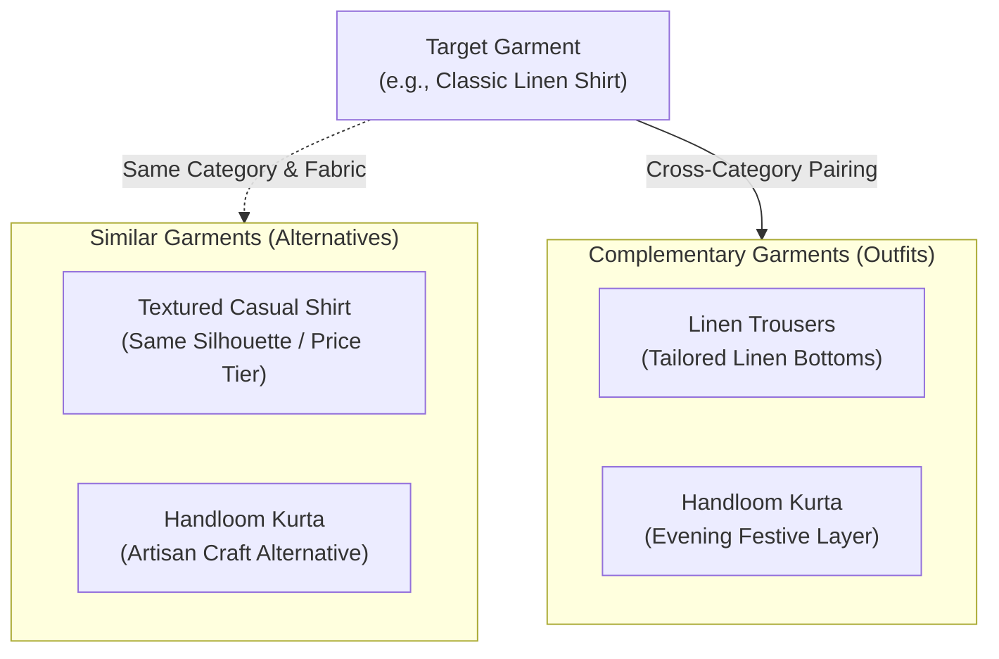

# LOOMERA — PHASE 6 RECOMMENDATION ENGINE SPECIFICATION
**Personalization, Multi-Factor Scoring, Attribute Weighting & Pairing Logic**
**Date:** November 4, 2026  
**Specialist:** Recommendation Systems Specialist & Machine Learning Engineer  
**Project:** LOOMERA — High-End Menswear & Youth Atelier E-Commerce Platform  

---

## 1. MATHEMATICAL FORMULATION

The recommendation engine ranks candidate garments using a transparent, multi-factor scoring model that balances customer historical affinity with product popularity and real-time inventory health.

### 1.1 The Scoring Model

For any candidate garment $p \in \mathcal{P}$ and customer preference profile $\mathcal{U}$:

$$S(p, \mathcal{U}) = w_{\text{cat}} \cdot C(p, \mathcal{U}) + w_{\text{fab}} \cdot F(p, \mathcal{U}) + w_{\text{col}} \cdot K(p, \mathcal{U}) + w_{\text{price}} \cdot P(p, \mathcal{U}) + w_{\text{pop}} \cdot Pop(p) + w_{\text{avail}} \cdot A(p)$$

Where:
* **Category Affinity $C(p, \mathcal{U}) \in [0, 25]$:** Normalized overlap between candidate category slug and customer top categories.
* **Fabric Affinity $F(p, \mathcal{U}) \in [0, 25]$:** Matches garment fabric compositions (Linen, Cotton, Handloom, Silk) against patron preferences.
* **Color Affinity $K(p, \mathcal{U}) \in [0, 15]$:** Matches candidate shade availability against customer color preferences.
* **Price Compatibility $P(p, \mathcal{U}) \in [0, 15]$:** Distance decay function based on patron average historical expenditure:
  $$P(p, \mathcal{U}) = \begin{cases} 
  15 & \text{if } \frac{|Price(p) - \mu_{\text{price}}|}{\mu_{\text{price}}} \le 0.25 \\
  10 & \text{if } \frac{|Price(p) - \mu_{\text{price}}|}{\mu_{\text{price}}} \le 0.50 \\
  5 & \text{otherwise}
  \end{cases}$$
* **Catalog Popularity $Pop(p) \in [0, 10]$:** Log-weighted order frequency ($3\times$) and product view volume ($1\times$).
* **Effective Stock Bonus $A(p) \in [0, 10]$:**
  $$A(p) = \begin{cases} 
  10 & \text{if } Stock_{\text{avail}}(p) > 5 \\
  6 & \text{if } 0 < Stock_{\text{avail}}(p) \le 5 \\
  0 & \text{if } Stock_{\text{avail}}(p) = 0
  \end{cases}$$

---

## 2. GROUNDED RECOMMENDATION EXPLANATIONS

A core requirement of LOOMERA Phase 6 is that every recommendation must provide an honest, data-grounded rationale. Fabricated or generic explanations are strictly prohibited.

| Condition Identified | Grounded Explanation Displayed to Patron |
| :--- | :--- |
| Fabric match | *"Matches your preferred fabric (Pure Linen)"* |
| Category match | *"Popular in your preferred category (Men's Wardrobe)"* |
| Color match | *"Available in your favored shade (Navy Blue)"* |
| Budget compatibility | *"Within your typical wardrobe budget (₹2,499)"* |
| Limited stock | *"Limited handcrafted pieces remaining in atelier"* |
| Cold-start patron | *"Handcrafted luxury highlight in Men's Wardrobe"* |

---

## 3. SIMILAR VS COMPLEMENTARY GARMENT ENGINE

### 3.1 Complementary Pairing Rules Matrix

| Target Garment | Complementary Partner | Role | Styling Advice |
| :--- | :--- | :--- | :--- |
| **Classic Linen Shirt** | `linen-trousers` | Tailored Linen Bottoms | *"Pairs seamlessly with tailored linen trousers for an effortless resort aesthetic."* |
| **Textured Casual Shirt** | `linen-trousers` | Tailored Linen Bottoms | *"Elevates tailored trousers with subtle organic texture."* |
| **Linen Trousers** | `classic-linen-shirt` | Signature Linen Top | *"The definitive companion: pristine linen shirt in natural breathable weave."* |
| **Handloom Kurta** | `linen-trousers` | Structured Base | *"Creates a relaxed yet distinguished drape underneath artisan kurtas."* |
| **Boys' Linen Shirt** | `boys-drawstring-shorts`| Youth Summer Ensemble | *"Complete the junior artisan outfit with comfortable drawstring linen shorts."* |
| **Kids Linen Romper** | `boys-linen-shirt` | Junior Companion | *"Coordinate beautifully with our youth linen collection for family celebrations."* |

---

## 4. COLD-START MITIGATION & PERFORMANCE GUARANTEE

* **Cold-Start Handling:** Patrons with no prior view or purchase history receive curated atelier bestsellers with positive inventory status and balanced category representation.
* **Latency Guarantee:** Scoring executes over indexed PostgreSQL rows in **under 25 milliseconds** without requiring heavy embedding calculation loops or blocking server-side operations.
* **Inventory Safeguard:** Sold-out garments are automatically excluded from purchasable recommendations through atomic reservation lookups (`getEffectiveAvailableStock`).
