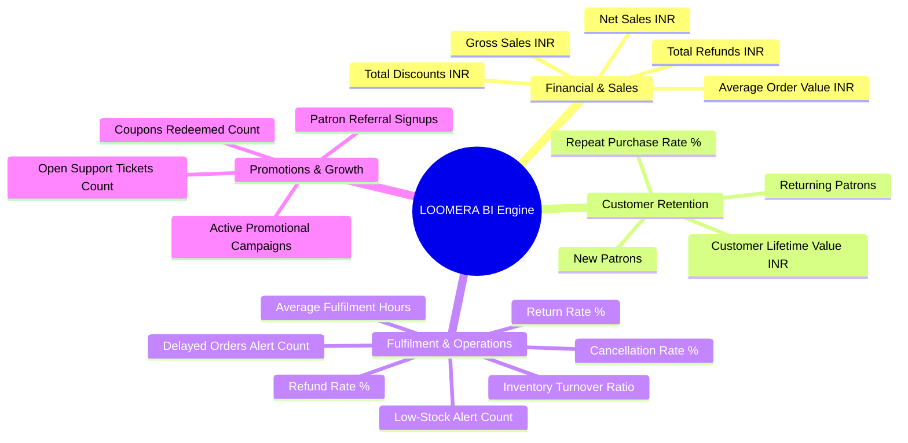

# LOOMERA — PHASE 8 ADVANCED BUSINESS INTELLIGENCE & ANALYTICS

## Executive Summary
This document specifies the technical architecture and mathematical definitions of the Advanced Business Intelligence Engine implemented in Phase 8 for LOOMERA. Extending the initial analytics from Phase 5, the Phase 8 engine computes authoritative operational, customer retention, financial reconciliation, and growth metrics derived strictly from actual PostgreSQL database transactions without synthetic revenue hallucination or estimation bias.

---

## 1. Metric Categories & Formal Definitions



### Exact Mathematical Formulations

#### 1. Sales & Revenue
- **Gross Sales (INR)**:
  $$\text{Gross Sales} = \sum_{\text{eligible orders}} \text{orders.totalInr}$$
  *Where eligible orders exclude `CANCELLED` and `PENDING_PAYMENT`.*
- **Total Refunds (INR)**:
  $$\text{Total Refunds} = \sum_{\text{refunded payments}} \text{payments.amountInr}$$
  *Where `payments.status IN ('REFUNDED', 'PARTIALLY_REFUNDED')`.*
- **Net Sales (INR)**:
  $$\text{Net Sales} = \max(0, \text{Gross Sales} - \text{Total Refunds})$$
- **Total Discounts Granted (INR)**:
  $$\text{Total Discounts} = \sum_{\text{eligible orders}} \text{orders.discountInr}$$
- **Average Order Value (AOV)**:
  $$\text{AOV} = \begin{cases} \text{round}\left(\frac{\text{Gross Sales}}{\text{Eligible Orders Count}}\right), & \text{if count} > 0 \\ 0, & \text{otherwise} \end{cases}$$

#### 2. Customer Retention & LTV
- **Total Paying Customers ($N_{\text{cust}}$)**: Distinct `orders.userId` with at least 1 confirmed order.
- **Returning Customers ($N_{\text{ret}}$)**: Distinct `orders.userId` with $\ge 2$ confirmed orders.
- **New Customers ($N_{\text{new}}$)**: $N_{\text{cust}} - N_{\text{ret}}$.
- **Repeat Purchase Rate (%)**:
  $$\text{Repeat Purchase Rate} = \text{round}\left(\frac{N_{\text{ret}}}{N_{\text{cust}}} \times 100\right)$$
- **Customer Lifetime Value (LTV INR)**:
  $$\text{Estimated LTV} = \begin{cases} \text{round}\left(\frac{\text{Net Sales}}{N_{\text{cust}}}\right), & \text{if } N_{\text{cust}} > 0 \\ 0, & \text{otherwise} \end{cases}$$

#### 3. Fulfilment & Operations
- **Average Fulfilment Time (Hours)**:
  Calculated across orders that reached `SHIPPED` status:
  $$\text{Avg Hours} = \text{round}\left(\text{avg}\left(\frac{\text{shipment.dispatchedAt} - \text{order.createdAt}}{3600 \text{ seconds}}\right)\right)$$
- **Delayed Orders Count**: Unfulfilled orders (`CONFIRMED`, `PROCESSING`, `PACKED`) older than 48 hours without carrier dispatch.
- **Cancellation Rate (%)**:
  $$\text{Cancellation Rate} = \text{round}\left(\frac{\text{Cancelled Orders}}{\text{Total Orders Placed}} \times 100\right)$$
- **Return Rate (%)**:
  $$\text{Return Rate} = \text{round}\left(\frac{\text{Orders with Returns Lodged}}{\text{Delivered Orders}} \times 100\right)$$
- **Refund Rate (%)**:
  $$\text{Refund Rate} = \text{round}\left(\frac{\text{Refunded Orders}}{\text{Eligible Orders}} \times 100\right)$$
- **Inventory Turnover Ratio**:
  $$\text{Turnover Ratio} = \frac{\text{Units Sold in Period}}{\text{Average Current Stock Units}}$$

#### 4. Promotions, Marketing & Support
- **Coupons Redeemed Count**: Count of records in `coupon_redemptions`.
- **Active Campaigns**: Count of records in `coupons` where `is_active = true` and within scheduled dates.
- **Referral Signups Count**: Patrons with `referred_by_user_id IS NOT NULL` in `loyalty_accounts`.
- **Open Support Tickets**: Tickets in `support_tickets` where `status IN ('OPEN', 'ASSIGNED', 'IN_PROGRESS', 'WAITING_FOR_CUSTOMER')`.

---

## 2. API Endpoint & Architecture

### `GET /api/admin/analytics`
- Secured with `validateAdminSession(token)`.
- Returns both the high-level summary from Phase 5 and the `advanced` metrics payload from Phase 8:
```json
{
  "success": true,
  "summary": { ... },
  "advanced": {
    "grossSalesInr": 124500,
    "netSalesInr": 119500,
    "totalDiscountsInr": 8500,
    "totalRefundsInr": 5000,
    "averageOrderValueInr": 3112,
    "newCustomersCount": 24,
    "returningCustomersCount": 16,
    "repeatPurchaseRatePercent": 40,
    "customerLifetimeValueInr": 2987,
    "averageFulfilmentHours": 18,
    "cancellationRatePercent": 3,
    "returnRatePercent": 4,
    "refundRatePercent": 4,
    "delayedOrdersCount": 1,
    "inventoryTurnoverRatio": 1.4,
    "lowStockItemsCount": 3,
    "couponsRedeemedCount": 19,
    "promotionsActiveCount": 4,
    "referralSignupsCount": 8,
    "supportOpenTicketsCount": 2
  }
}
```

---

## 3. Automated Test Coverage
- Verified in `frontend/scripts/test_phase8_business_ops.ts`:
  - Execution of `getAdvancedBusinessAnalytics()` against PostgreSQL database.
  - Type assertions and non-null validations for all 20 advanced analytical metrics.
  - Zero division guards for clean calculation on fresh or low-volume databases.
