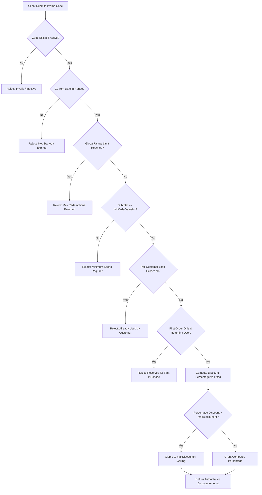

# LOOMERA — PHASE 8 COUPONS & PROMOTIONS ENGINE

## Executive Summary
This document specifies the technical architecture and security rules of the LOOMERA Promotions & Coupon Engine implemented in Phase 8. The engine delivers flexible promotional capabilities—including percentage discounts, fixed rupee amounts, order spend thresholds, per-customer caps, and first-order promotions—while strictly preventing discount manipulation, client price tampering, and race conditions on redemption limits.

---

## 1. Architectural Principles

### Absolute Server-Side Authority
- **Zero Client Trust**: The frontend client never computes or transmits discount amounts. The client submits only the promo code string (e.g. `WELCOME10`).
- **Server Calculation**: The server retrieves the verified coupon from PostgreSQL, checks active dates, spend thresholds, customer redemption history, computes the exact INR discount, clamps it to maximum discount ceilings, and calculates `finalTotal = Math.max(0, subtotal + shippingFee - discount)`.
- **Paise Precision**: The authoritative server total is converted to integer paise (`Math.round(totalInr * 100)`) for Razorpay cryptographic payment initiation.

---

## 2. Supported Promotion Types & Restriction Rules

### Supported Restriction Matrix

| Rule Parameter | Type | Business Function |
| :--- | :--- | :--- |
| `code` | `VARCHAR(50)` | Case-insensitive uppercase promo identifier (e.g. `ATELIER15`). |
| `discountType` | `ENUM` | `PERCENTAGE` or `FIXED_AMOUNT`. |
| `discountValue` | `INTEGER` | Percentage integer (e.g. `15` for 15%) or flat rupees (e.g. `500` for ₹500). |
| `maxDiscountInr` | `INTEGER` | Absolute monetary cap applied to percentage promotions (e.g. max ₹1,000 off). |
| `minOrderValueInr` | `INTEGER` | Minimum cart subtotal required to activate promotion (e.g. ₹2,999). |
| `usageLimit` | `INTEGER` | Global cap on total redemptions across all patrons. |
| `perCustomerLimit`| `INTEGER` | Maximum redemptions permitted per patron account (default: `1`). |
| `firstOrderOnly` | `BOOLEAN` | Restricts promotion to patrons with 0 prior confirmed orders. |
| `startsAt`, `expiresAt`| `TIMESTAMP` | Start and expiration schedule with 10-second skew tolerance. |
| `isActive` | `BOOLEAN` | Instant kill-switch allowing administrators to deactivate campaigns. |

---

## 3. Database Schema
- **`coupons` Table**: Stores coupon campaign configurations, rules, and live `usage_count`.
- **`coupon_redemptions` Table**:
  - `id`: UUID primary key.
  - `coupon_id`: References `coupons.id`.
  - `user_id`: References `users.id`.
  - `order_id`: References `orders.id`.
  - `discount_amount_inr`: Exact discount granted at time of checkout.
  - `created_at`: Immutable timestamp.

---

## 4. Administrative Management Console

Located at `/admin/promotions`:
- **Campaign Dashboard**: View active vs. expired vouchers, total redemptions, and total capital discounted.
- **Voucher Creator**: Form to issue new percentage or fixed coupons with custom spend limits, expiry dates, and usage limits.
- **Campaign Status Toggle**: One-click enable/disable toggle.
- **Redemption Audit Ledger**: Detailed table tracking which patron redeemed which voucher on which order reference.

---

## 5. Automated Test Coverage
- Verified in `frontend/scripts/test_phase8_business_ops.ts`:
  - `PERCENTAGE` discount calculation clamped at `maxDiscountInr`.
  - `FIXED_AMOUNT` flat discount granting exact rupee savings.
  - Rejection of carts below `minOrderValueInr`.
  - Rejection of inactive vouchers.
  - Rejection of expired vouchers.
