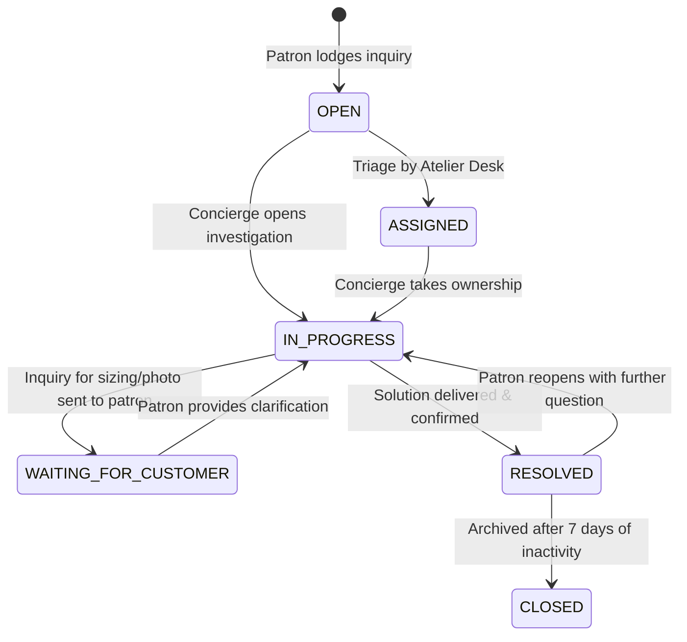

# LOOMERA — PHASE 8 CUSTOMER SERVICE & SUPPORT DESK ARCHITECTURE

## Executive Summary
This document specifies the technical architecture, security protocols, and operational workflows of the integrated Customer Support Helpdesk implemented in Phase 8 for LOOMERA. The system bridges customer inquiries directly to the administrative atelier concierge desk while integrating with the platform's AI Assistant for instant, safe, database-verified answers.

---

## 1. Ticket Taxonomy & Lifecycle Management

Inquiries are organized into **six standardized categories**:
- `ORDER_STATUS`: Live carrier tracking, dispatch manifests, transit delays.
- `DELIVERY`: Address updates, delivery rescheduling, courier contact.
- `RETURN_REFUND`: 15-day bespoke guarantee, exchange size requests, inspection status.
- `PRODUCT_INQUIRY`: Fabric care, weave authenticity, alteration styling.
- `ACCOUNT`: Password reset, profile changes, notification preferences.
- `GENERAL`: Bespoke atelier questions, gifting consultations.

### Lifecycle Status Flow


---

## 2. Security & Anti-IDOR Protections

Customer support messages frequently contain private contact, address, or payment details. Strict access controls prevent Insecure Direct Object Reference (IDOR) attacks:

1. **Patron Isolation**:
   ```typescript
   export async function getSupportTicketDetails(ticketId: string, userId: string, isAdmin = false) {
     const [ticket] = await db.select().from(supportTickets).where(eq(supportTickets.id, ticketId)).limit(1);
     if (!ticket) return null;

     // Strict ownership barrier: patrons can NEVER query or reply to tickets owned by another user
     if (!isAdmin && ticket.userId !== userId) {
       throw new Error("Unauthorized to access this support ticket");
     }
     ...
   }
   ```
2. **Order Cross-Verification**:
   When a ticket references an `orderId`, the service verifies that `order.userId === session.user.id`. Submitting inquiries for other users' orders is rejected with `403 Forbidden`.

---

## 3. AI Assistant Integration & Grounded Order Tool

Phase 8 extends the existing AI Assistant with an authoritative server-side tool:
`getVerifiedOrderStatusTool(params: { userId: string, orderNumber?: string, orderId?: string })`

### Safety & Grounding Invariants
- **Strictly Grounded**: The tool queries the PostgreSQL `orders` and `shipments` tables directly. It never hallucinates order dates, delivery promises, or refund statuses.
- **No Unauthorized Modifications**: The AI assistant is strictly read-only. It cannot approve refunds, issue discounts, or modify orders directly. For actions requiring human review, the AI instructs the patron to use the native return modal or lodge a concierge ticket.
- **Scope Enforced**: The tool enforces `WHERE orders.userId = userId`, preventing patrons from inquiring about other customers' orders via prompt injection.

---

## 4. Administrative Support Helpdesk Console

Located at `/admin/support`:
- **Real-Time Ticket Queue**: Shows tickets filtered by status (`OPEN`, `IN_PROGRESS`, `RESOLVED`, `ALL`) and priority (`URGENT`, `HIGH`, `MEDIUM`, `LOW`).
- **Ticket Thread Inspector**: Full chronological conversation history between patron and atelier agents.
- **Action Toolbar**:
  - Update Status: Toggle between `IN_PROGRESS`, `WAITING_FOR_CUSTOMER`, `RESOLVED`, `CLOSED`.
  - Update Priority: Escalate urgent shipping problems or VIP patron inquiries.
  - Reply Dispatch: Send rich messages that immediately trigger patron in-app alerts and email notifications.

---

## 5. Automated Test Coverage
- Verified in `frontend/scripts/test_phase8_business_ops.ts`:
  - Customer ticket creation in `OPEN` status.
  - Concierge response message recording in conversation thread.
  - Customer ticket listing retrieval scoped to authenticated user ID.
  - AI assistant verified order status tool execution against PostgreSQL database.
