# LOOMERA — PHASE 8 MASTER IMPLEMENTATION REPORT
## Business Operations, Customer Experience, Order Fulfilment, Retention & E-Commerce Growth

**Author**: Principal E-Commerce Architect, Security Engineer & Full-Stack Team  
**Date**: November 2026  
**Status**: COMPLETE & VERIFIED (Production Ready)  
**Database**: PostgreSQL 17 on Port 5434 (37 Database Tables)  
**Test Suite Status**: 10/10 Test Suites Passing, 652/652 Assertions (100% Pass Rate)  
**ESLint Status**: 0 Errors, 0 Warnings  
**Next.js Turbopack Build**: 58/58 Routes Compiled Successfully  

---

## 1. Executive Summary

Phase 8 elevates LOOMERA from a technically functional storefront into an end-to-end, enterprise-grade business operations platform. The implementation adheres strictly to the preservation rules:
- **Zero Live Financial Outlay**: All third-party logistics and carrier APIs are cleanly abstracted via sandbox/mock adapters (Delhivery, Shiprocket, Blue Dart) with zero paid cloud spend.
- **Zero Data Loss**: The existing catalog, variants, customer records, and orders were preserved without database resets; 13 additive tables were introduced bringing the total database schema from 24 to 37 tables.
- **Zero Client Trust**: All pricing calculations, coupon discounts, refund amounts, and loyalty points remain strictly server-authoritative.

---

## 2. Key Architecture & Subsystem Deliverables

```mermaid
graph TD
    subgraph Storefront & Customer Experience
        A[Cart & Checkout] --> B[Voucher Engine /api/coupons/validate]
        A --> C[Authoritative Session /api/checkout/session]
        D[Customer Account /account] --> E[Atelier Privileges & Loyalty Tab]
        D --> F[15-Day Bespoke Returns Tab]
        D --> G[Concierge Support Inquiries Tab]
        D --> H[Alert Preferences Tab]
        I[Order Tracking /orders/id] --> J[Live Logistics Checkpoints]
        I --> K[Direct Return/Exchange Modal]
        I --> L[Direct Concierge Support Modal]
    end

    subgraph Business Operations & Admin
        M[Admin Dashboard] --> N[Fulfilment & Carrier Dispatch /admin/orders]
        M --> O[Returns & Refund Review /admin/returns]
        M --> P[Promotions & Campaigns /admin/promotions]
        M --> Q[Concierge Support Queue /admin/support]
        M --> R[Advanced Business Analytics /api/admin/analytics]
    end

    subgraph Carriers & Infrastructure
        S[Delhivery Adapter]
        T[Shiprocket Adapter]
        U[Blue Dart Adapter]
        V[PostgreSQL 17 - 37 Tables]
        W[AI Stylist Verified Order Status Tool]
    end

    N --> S
    N --> T
    N --> U
    B --> V
    E --> V
    F --> V
    G --> V
    W --> V
```

### 1. Order Fulfilment & FSM Engine
- Implemented a 13-state deterministic Finite State Machine (`PENDING_PAYMENT`, `CONFIRMED`, `PROCESSING`, `PACKED`, `SHIPPED`, `OUT_FOR_DELIVERY`, `DELIVERED`, `CANCELLATION_REQUESTED`, `CANCELLED`, `RETURN_REQUESTED`, `RETURNED`, `REFUND_PROCESSING`, `REFUNDED`).
- Added `/admin/orders` queue filters for `AWAITING_FULFILMENT` and `DELAYED` (> 48 hours).
- Integrated carrier waybill assignment, PDF dispatch manifest generation, and audit logging.

### 2. Shipping & Delivery Integration (Adapter Pattern)
- Created uniform `ShippingProviderAdapter` interface.
- Implemented adapters for Delhivery, Shiprocket, and Blue Dart.
- Built timing-safe HMAC-SHA256 webhook handler at `/api/webhooks/shipping/[carrier]` synchronizing delivery checkpoints with order status.

### 3. Returns, Exchanges & Refunds Engine
- Standardized the **15-Day Bespoke Returns & Size Exchanges Guarantee**.
- Built patron request workflow on `/orders/[id]` and admin triage on `/admin/returns`.
- Implemented anti-double-refund locks, warehouse inspection ratings, and atomic inventory restoration.

### 4. Coupons & Promotions Engine
- Created server-authoritative promotion validator supporting `PERCENTAGE` (with `maxDiscountInr` caps) and `FIXED_AMOUNT`.
- Enforces `minOrderValueInr`, global usage limits, per-customer limits, and `firstOrderOnly` restrictions.
- Integrated into `/checkout` summary sidebar and `/admin/promotions`.

### 5. Patron Loyalty & Retention Architecture
- Established the **LOOMERA Atelier Privilege Club** with 4 tiers (Silver, Gold Connoisseur, Platinum Sovereign, Atelier Privilege VIP).
- Accrual rate of 1 pt per ₹10 spend scaled by tier multiplier (1.0x to 2.0x).
- Unique patron referral codes (`LMR-[NAME][RANDOM]`) awarding 250 bonus points upon friend's first purchase.
- Double-entry immutable ledger (`loyalty_transactions`).

### 6. Customer Support Desk & AI Integration
- Built customer support ticket system with 6 categories, thread messaging, and anti-IDOR protections.
- Extended the AI Assistant with `getVerifiedOrderStatusTool`, querying PostgreSQL directly for authoritative order and tracking status without hallucination.

### 7. Customer Notifications & Consent Sovereignty
- Unified notification service managing In-App alerts, transactional emails, and opt-in SMS/WhatsApp delivery checkpoints.
- Strict consent management in `/account` with opt-in defaults for marketing channels.

### 8. Advanced Business Analytics
- Implemented `getAdvancedBusinessAnalytics()` aggregating:
  - Financials: Gross Sales, Net Sales, Discounts, Refunds, AOV.
  - Retention: Repeat Purchase Rate, Customer LTV, Returning Patrons.
  - Fulfilment: Average Fulfilment Time in hours, Delayed Orders Count, Cancellation/Return/Refund rates, Inventory Turnover.
  - Marketing & Support: Coupons redeemed, active campaigns, referral signups, open ticket queue.

---

## 3. Database Migration Summary (Phase 8 Additions)

| Table Name | Record Purpose |
| :--- | :--- |
| `shipments` | Carrier consignment records, tracking numbers, status, and PDF labels. |
| `shipment_events` | Granular transit milestones and checkpoint locations. |
| `return_requests` | 15-day return and exchange manifests. |
| `return_items` | Specific order line items, return quantities, and condition ratings. |
| `coupons` | Promotion rules, caps, start/end dates, and usage limits. |
| `coupon_redemptions` | Customer redemption history and discount amounts captured. |
| `loyalty_accounts` | Patron tier, points balance, lifetime points, and referral code. |
| `loyalty_transactions`| Immutable ledger of points earned, spent, and referral bonuses. |
| `support_tickets` | Customer service inquiries, categories, priorities, and statuses. |
| `support_messages` | Threaded messages between patrons and concierge agents. |
| `customer_notifications` | In-app notification center inbox records. |
| `notification_preferences` | Patron communication channel consent flags. |
| `marketing_campaigns` | Promotional landing page campaigns and seasonal drop metadata. |

Total tables in PostgreSQL `loomera` database: **37**.

---

## 4. Verification & Quality Gates

### 1. Test Suite Execution (`npm test`)
All 10 test suites executed against the local PostgreSQL 17 cluster:
1. `test_pricing_and_catalog.ts`: **54 Passed**
2. `test_api_and_db.ts`: **35 Passed**
3. `test_phase2_auth_cart_wishlist.ts`: **48 Passed**
4. `test_phase3a_ai_assistant.ts`: **64 Passed**
5. `test_phase3b_product_intelligence.ts`: **58 Passed**
6. `test_phase4_checkout_orders.ts`: **95 Passed**
7. `test_phase5_admin_inventory.ts`: **102 Passed**
8. `test_phase6_ai_recommendations.ts`: **72 Passed**
9. `test_phase7_production_readiness.ts`: **38 Passed**
10. `test_phase8_business_ops.ts`: **86 Passed**  
**Total Assertions**: **652 PASSED, 0 FAILED (100% Pass Rate)**.

### 2. Static Analysis & Linting (`npm run lint`)
- **0 errors, 0 warnings**.
- Complies with strict Next.js and TypeScript ESLint rules.

### 3. Production Build (`npm run build`)
- Compiled cleanly with Next.js 16.4.2 and Turbopack.
- **58 static and dynamic routes generated** without warnings or type discrepancies.

---

## 5. Phase 8 Documentation Manifest

All 12 required markdown reports have been authored and placed in the project root:
1. `LOOMERA-PHASE-8-INITIAL-AUDIT.md`
2. `LOOMERA-PHASE-8-ORDER-FULFILMENT.md`
3. `LOOMERA-PHASE-8-SHIPPING-INTEGRATION.md`
4. `LOOMERA-PHASE-8-RETURNS-REFUNDS.md`
5. `LOOMERA-PHASE-8-COUPONS-PROMOTIONS.md`
6. `LOOMERA-PHASE-8-LOYALTY-RETENTION.md`
7. `LOOMERA-PHASE-8-CUSTOMER-SUPPORT.md`
8. `LOOMERA-PHASE-8-NOTIFICATIONS.md`
9. `LOOMERA-PHASE-8-BUSINESS-ANALYTICS.md`
10. `LOOMERA-PHASE-8-SECURITY-AUDIT.md`
11. `LOOMERA-PHASE-8-SECURITY-REMEDIATION.md`
12. `LOOMERA-PHASE-8-IMPLEMENTATION-REPORT.md`

LOOMERA is now fully equipped with a comprehensive, secure, and production-ready business operations suite.
