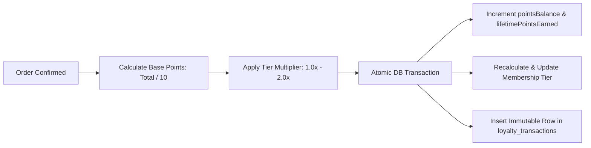

# LOOMERA — PHASE 8 CUSTOMER LOYALTY & RETENTION ARCHITECTURE

## Executive Summary
This document specifies the technical architecture and economic framework of the **LOOMERA Atelier Privilege Club** implemented in Phase 8. The program fosters patron retention, repeat purchases, and viral word-of-mouth growth through tiered memberships, transparent point accrual, referral bonuses, and immutable ledger accounting with zero financial liability runaway.

---

## 1. Membership Tiers & Economic Design

The program is structured into **four aspirational tiers** reflecting lifetime patronage:

| Membership Tier | Lifetime Points Qualifier | Spend Multiplier | Exclusive Tier Privileges |
| :--- | :--- | :--- | :--- |
| **Silver Patron** | 0 – 4,999 pts | 1.0x (1 pt per ₹10 spend) | 100 Welcome Points upon registration; Standard delivery tracking; 15-day bespoke return guarantee. |
| **Gold Connoisseur** | 5,000 – 14,999 pts | 1.25x (+25% bonus) | Complimentary alterations coverage; Priority dispatch from atelier; Curated seasonal fabric swatches. |
| **Platinum Sovereign** | 15,000 – 29,999 pts | 1.50x (+50% bonus) | Dedicated styling concierge; Early 48-hour access to festive drops; Complimentary express air shipping on all orders. |
| **Atelier Privilege VIP** | 30,000+ pts | 2.00x (+100% bonus) | Private guild bespoke commissions; Handloom artisan meet-and-greets; Annual anniversary luxury gift voucher. |

---

## 2. Immutable Ledger & Double-Entry Accounting

To prevent balance tampering and ensure absolute auditability:
1. **Client Read-Only**: Clients cannot send points balance mutations. All updates are triggered exclusively by authoritative backend events:
   - Order Confirmation $\rightarrow$ `awardPurchasePoints`
   - Friend First Purchase $\rightarrow$ `awardReferralBonus`
   - Checkout Redemption $\rightarrow$ `redeemPointsForDiscount`
2. **Double-Entry Transaction Ledger (`loyalty_transactions`)**:
   - `accountId`: References `loyalty_accounts.id`.
   - `type`: `PURCHASE_EARN`, `REFERRAL_BONUS`, `REDEMPTION`, `TIER_UPGRADE`, `MANUAL_ADJUSTMENT`.
   - `pointsDelta`: Signed integer (+ or -).
   - `balanceAfter`: Balance state immediately following transaction.
   - `referenceType`: `ORDER`, `REFERRAL`, `ADMIN`.
   - `referenceId`: Associated order ID or referee ID.
   - `description`: Human-readable explanation.
   - `createdAt`: Immutable ISO timestamp.

---

## 3. Referral Program & Viral Acquisition Loop

Every patron receives a unique branded referral code (e.g. `LMR-ARJU4387`) upon account creation:
1. **Sharing**: Patrons share their referral voucher with colleagues and friends.
2. **First Commission Qualifier**: When the invited patron registers and confirms their first tailored garment order:
   - Referrer receives **250 bonus points**.
   - Referee receives **250 bonus points** credited to their welcome ledger.
3. **Sybil & Self-Referral Protection**:
   - Patrons cannot refer their own account (`referrerAccountId !== refereeAccountId`).
   - Only one referral bonus can be claimed per newly registered user (`referredByUserId` column constraint).

---

## 4. Patron Storefront Experience

In `/account` under the **Atelier Privileges** tab:
- **Digital Membership Card**: Highlighting current tier name, multiplier, and points balance.
- **Referral Box**: Displays personal code with one-click copy feedback.
- **Points Ledger**: Transparent historical record showing every point earned or redeemed.

---

## 5. Automated Test Coverage
- Verified in `frontend/scripts/test_phase8_business_ops.ts`:
  - Tier determination function across boundary conditions (0, 5500, 16000, 35000 pts).
  - Referral code generation formatting (`LMR-[NAME][RANDOM]`).
  - Welcome point allocation (100 pts) on initial account creation.
  - Transaction history immutability and ledger integrity.
