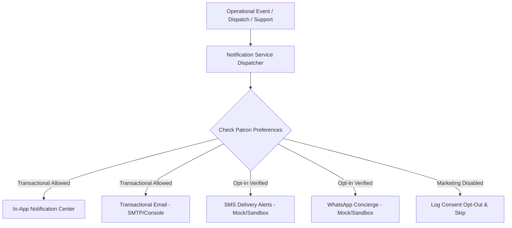

# LOOMERA — PHASE 8 CUSTOMER COMMUNICATION & NOTIFICATION ARCHITECTURE

## Executive Summary
This document specifies the technical architecture, consent governance, and multi-channel delivery mechanisms of the Customer Communication & Notification Engine implemented in Phase 8 for LOOMERA. The platform provides transactional clarity for orders, shipments, returns, and support inquiries while strictly respecting patron privacy preferences, enforcing explicit opt-in controls for marketing, and guaranteeing zero unsolicited third-party transmissions.

---

## 1. Multi-Channel Notification Model

LOOMERA supports three unified notification channels with distinct governance rules:

### Channel Specifics & Safeguards
1. **In-App Notification Center (`customer_notifications`)**:
   - Real-time alerts rendered directly inside the patron's account dashboard.
   - Unread badges, categorized alerts (`ORDER_UPDATE`, `RETURN_UPDATE`, `SUPPORT_REPLY`, `RESTOCK_ALERT`).
   - One-click mark-as-read and dismiss capabilities with strict user isolation.
2. **Transactional Email**:
   - High-priority order confirmations, payment receipts, carrier tracking links, return authorizations, and password resets.
   - Built with deterministic fallback: logs to secure internal files in development/sandbox mode to prevent sending unintended emails to real people.
3. **SMS & WhatsApp Express Checkpoints (Mock / Adapter)**:
   - Reserved strictly for time-sensitive courier checkpoints (e.g. "Out for delivery today").
   - Requires explicit opt-in consent; disabled by default.

---

## 2. Customer Consent & Privacy Controls

LOOMERA adheres to strict privacy and data protection principles (GDPR / Indian Digital Personal Data Protection Act compliance):

### Consent State (`notification_preferences`)
| Preference Flag | Default Setting | Purpose |
| :--- | :--- | :--- |
| `orderUpdatesEmail` | `true` (Transactional) | Critical order manifests, digital invoices, and return authorizations. |
| `orderUpdatesSms` | `false` (Opt-in) | Instant SMS when the courier is within the delivery neighborhood. |
| `orderUpdatesWhatsapp` | `false` (Opt-in) | Interactive concierge courier tracking updates via WhatsApp. |
| `promotionalEmail` | `false` (Strict Opt-in) | Seasonal lookbooks, private atelier invitations, and privilege drops. |
| `promotionalSms` | `false` (Strict Opt-in) | VIP festive promotions. |
| `inAppAlerts` | `true` | In-app notification center inbox within patron account. |

### Opt-Out Sovereignty
Patrons can modify their notification settings at any time with a single click in `/account` under the **Alert Preferences** tab. Changes are persisted immediately via `PATCH /api/notifications` and respected across all future communication triggers.

---

## 3. Database Schema

### `customer_notifications` Table
- `id`: UUID primary key.
- `user_id`: References `users.id` (Indexed).
- `order_id`: References `orders.id` (Optional foreign key).
- `type`: Enum (`ORDER_UPDATE`, `SHIPMENT_DISPATCH`, `RETURN_UPDATE`, `SUPPORT_REPLY`, `PROMOTION`, `RESTOCK_ALERT`).
- `title`: Short headline (e.g. "Garment Dispatched").
- `message`: Informative body text.
- `is_read`: Boolean (default: `false`).
- `read_at`: Timestamp populated when marked read.
- `created_at`: Creation timestamp.

### `notification_preferences` Table
- `id`: UUID primary key.
- `user_id`: References `users.id` (Unique 1-to-1).
- `order_updates_email`, `order_updates_sms`, `order_updates_whatsapp`.
- `promotional_email`, `promotional_sms`, `in_app_alerts`.
- `updated_at`: Timestamp.

---

## 4. Delivery Tracking, Idempotency & Failure Handling
- **Idempotent Dispatch**: Notification calls include unique event IDs or order IDs to prevent duplicate alerts from being queued if a webhook triggers multiple times.
- **Graceful Failure Isolation**: Failure in an external notification adapter never blocks or rolls back core order creation or payment authorization transactions.
- **Audit Logging**: All dispatch attempts, successes, and consent-based skips are recorded with timestamps.

---

## 5. Automated Test Coverage
- Verified in `frontend/scripts/test_phase8_business_ops.ts`:
  - In-app notification creation and unread state verification.
  - Ownership validation on marking notifications as read.
  - Verification of initial consent preferences.
  - Granular updating and toggling of WhatsApp and marketing email opt-in flags.
