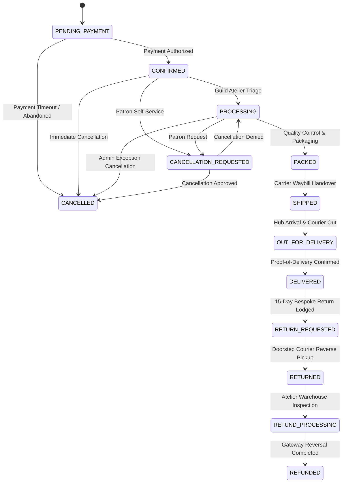

# LOOMERA — PHASE 8 ORDER FULFILMENT SPECIFICATION & ARCHITECTURE

## Executive Summary
This document specifies the comprehensive order fulfilment engine and finite state machine (FSM) implemented in Phase 8 for LOOMERA. The platform transitions from simple payment capture into a full lifecycle business operations suite managing inventory commitments, tailoring processing, carrier manifest dispatch, and exception handling with strict role-based access control and immutable audit trails.

---

## 1. Order Lifecycle & Finite State Machine (FSM)

The LOOMERA order management system supports **13 deterministic lifecycle states**:

### Complete Allowed Transitions Matrix

| Current State | Permitted Next States | Guard & Authorization Rules |
| :--- | :--- | :--- |
| `PENDING_PAYMENT` | `CONFIRMED`, `CANCELLED` | System payment gateway webhook or patron timeout. |
| `CONFIRMED` | `PROCESSING`, `CANCELLATION_REQUESTED`, `CANCELLED` | Admin role required for `PROCESSING`; Customer or Admin for cancel. |
| `PROCESSING` | `PACKED`, `CANCELLATION_REQUESTED`, `CANCELLED` | Packing slips printed; inventory committed. |
| `PACKED` | `SHIPPED` | Carrier dispatch manifest generated with valid AWB tracking number. |
| `SHIPPED` | `OUT_FOR_DELIVERY` | Carrier webhook checkpoint or admin sync. |
| `OUT_FOR_DELIVERY` | `DELIVERED` | Carrier delivery confirmation timestamp recorded. |
| `DELIVERED` | `RETURN_REQUESTED` | Order must be within the 15-day return window. |
| `CANCELLATION_REQUESTED`| `CANCELLED`, `PROCESSING` | Admin approval; triggers committed stock restoration. |
| `CANCELLED` | *Terminal State* | No transitions allowed. Stock restored. |
| `RETURN_REQUESTED` | `RETURNED`, `DELIVERED` | Return request approved; reverse waybill created. |
| `RETURNED` | `REFUND_PROCESSING` | Physical garment inspection verified at warehouse. |
| `REFUND_PROCESSING` | `REFUNDED` | Gateway refund processed; double-refund lock enforced. |
| `REFUNDED` | *Terminal State* | Financial ledger closed. |

---

## 2. Admin Fulfilment Operations Dashboard

Located at `/admin/orders`, the fulfilment console empowers administrators and warehouse managers with:
1. **Dynamic Queue Filtering**:
   - `ALL`: Complete order book.
   - `AWAITING_FULFILMENT`: Instant filter for orders in `CONFIRMED`, `PROCESSING`, and `PACKED` awaiting shipment.
   - `DELAYED`: Automated alert filter identifying unfulfilled orders older than 48 hours.
   - Granular status filters matching each individual state.
2. **Order Detail Inspection**:
   - Customer profile, email, and phone contact details.
   - Full delivery address with PIN code validation.
   - Detailed garment breakdowns (title, shade, tailoring size, unit price, quantity, line item total).
   - Authoritative invoice summary (subtotal, shipping fee, voucher discount, total captured).
   - Live payment ref and gateway status.
3. **Carrier Dispatch Modal**:
   - Selection between Delhivery, Shiprocket, and Blue Dart.
   - Instant generation of carrier tracking numbers (e.g. `DELH-XXXX`, `SR-XXXX`, `BD-XXXX`).
   - Generation of official PDF dispatch manifest and printable labels (`https://track.loomera.com/labels/...`).
4. **Administrative Audit Logging**:
   - Every single status transition records an entry in `admin_audit_logs` storing: `actorId`, `actorRole`, `action: ORDER_STATUS_UPDATE`, `entityType: ORDER`, `metadata: { previousStatus, newStatus, reason }`.

---

## 3. Customer Order Tracking & Experience

Storefront patrons access their dispatch manifest directly at `/orders/[id]`:
- **Real-Time Logistics Timeline**: Displays carrier badge, live status, tracking number, and external tracking link.
- **Milestone Checkpoints**: Chronological updates showing transit hubs, sorting center timestamps, and arrival estimates.
- **Cancellation Controls**: For orders in `PENDING_PAYMENT`, `CONFIRMED`, or `PROCESSING`, patrons can cancel instantly with automatic inventory restoration.
- **15-Day Return & Size Exchange**: When an order reaches `DELIVERED`, an interactive modal appears allowing patrons to request a return or size exchange under the 15-day atelier guarantee.
- **Concierge Support Integration**: Patrons can initiate direct support inquiries regarding transit delays or bespoke care directly from the order screen.

---

## 4. Verification & Automated Test Coverage
- **Transition FSM Suite**: 17 dedicated tests in `frontend/scripts/test_phase8_business_ops.ts` verifying all legal and illegal state transitions.
- **Permissions Guard**: Ensures non-admin roles cannot force status updates via administrative endpoints.
- **Idempotency**: Duplicate carrier status updates are safely deduplicated.
