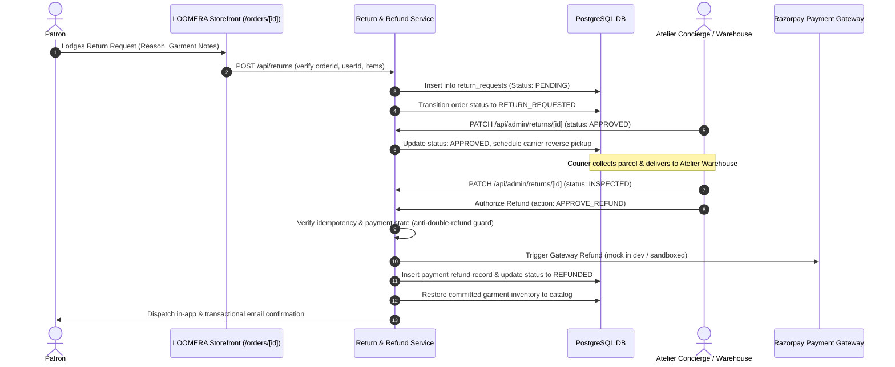

# LOOMERA — PHASE 8 RETURNS, EXCHANGES & REFUNDS POLICY & ENGINE

## Executive Summary
This document outlines the business rules, security safeguards, and technical workflows governing LOOMERA's **15-Day Bespoke Returns & Size Exchanges Guarantee**. The platform protects patron trust while maintaining rigorous financial idempotency, preventing double-refunding, enforcing physical warehouse garment inspections, and restoring inventory automatically upon authorized returns.

---

## 1. Business Policy & Eligibility Window

### Core Policy Principles
- **15-Day Return Window**: Calculated from the exact delivery timestamp recorded by the carrier.
- **Condition Requirements**: Garments must be unworn, unwashed, unaltered, and possess original atelier handloom tags attached.
- **Doorstep Reverse Logistics**: Complimentary reverse courier pickup scheduled to the patron's destination address upon authorization.
- **Exchange Prioritization**: Patrons experiencing sizing discrepancies can opt for alternate sizes without waiting for refund cycles.
- **Financial Protection**: Refunds are credited exclusively to the original payment method via the secure payment gateway ledger.

### Eligibility Gate Checks
```typescript
const isDelivered = order.status === "DELIVERED";
const daysSinceDelivery = (Date.now() - new Date(order.updatedAt).getTime()) / (1000 * 3600 * 24);
const isEligible = isDelivered && daysSinceDelivery <= 15;
```

---

## 2. Multi-Stage Return & Refund Workflow



---

## 3. Financial & Operational Safeguards

### Safeguard 1: Anti-Double-Refund Guard
To prevent duplicate refund requests from draining business capital during concurrent requests:
1. `return_requests.status` is checked atomically inside a PostgreSQL serializable transaction. If status is already `REFUNDED` or `REFUND_PROCESSING`, the operation is aborted immediately with `409 Conflict`.
2. Existing payments table is checked: `SELECT SUM(amount) FROM payments WHERE order_id = $1 AND status = 'REFUNDED'`. If total refunded equals or exceeds `order.totalInr`, further refund executions are blocked.

### Safeguard 2: Physical Inspection Verification
Refund approvals require explicit warehouse inspection input:
- Garment condition rating recorded (`TAGS_ATTACHED`, `UNWORN`, `DAMAGED_IN_TRANSIT`, `WORN_OR_WASHED`).
- Inspection notes documented in `admin_audit_logs`.
- If garments exhibit unauthorized wear or missing tags, administrators reject the claim with documented photographic reasoning.

### Safeguard 3: Atomic Inventory Restoration
When a return request is marked `REFUNDED`:
```typescript
if (restoreStock) {
  for (const item of returnItems) {
    await tx.update(productVariants)
      .set({ stockQuantity: sql`${productVariants.stockQuantity} + ${item.quantity}` })
      .where(eq(productVariants.id, item.variantId));

    await tx.insert(inventoryMovements).values({
      variantId: item.variantId,
      movementType: "RETURN_RESTORE",
      quantityDelta: item.quantity,
      referenceType: "RETURN",
      referenceId: returnId,
    });
  }
}
```

---

## 4. Administrative Returns Console

Located at `/admin/returns`:
- **Live Returns Manifest**: Shows all pending, approved, inspected, and refunded claims.
- **Customer Identity**: Patron name, phone, email, and order number.
- **Refund Metric Tracker**: Displays real-time aggregate of total refunded capital and return rate percentages.
- **Modal Review**: Complete line item breakdown with sizes, quantities, patron feedback, and one-click inspection approval or rejection.

---

## 5. Verification & Test Suite
- Automated testing in `test_phase8_business_ops.ts` confirms:
  - FSM transitions `DELIVERED -> RETURN_REQUESTED -> RETURNED -> REFUND_PROCESSING -> REFUNDED`.
  - Illegal status jumps (e.g. attempting return on `PROCESSING` order) are rejected with `400 Bad Request`.
  - Non-owner return submissions are blocked by IDOR validation.
