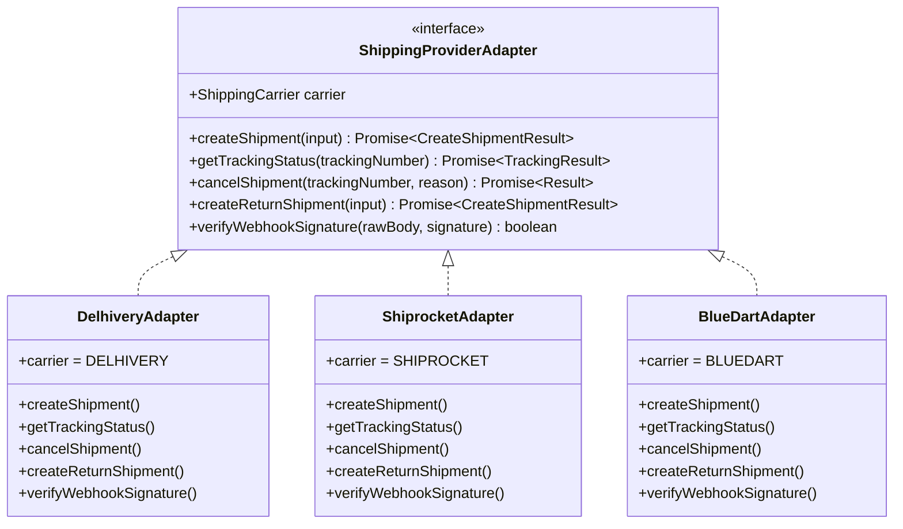

# LOOMERA — PHASE 8 SHIPPING & DELIVERY INTEGRATION

## Executive Summary
This document provides the technical specification and architectural analysis for the logistics and carrier integration subsystem implemented in Phase 8 for LOOMERA. The implementation uses a clean **Adapter Design Pattern** to support leading Indian domestic couriers—Delhivery, Shiprocket, and Blue Dart—with zero live vendor billing, realistic sandbox mock adapters, cryptographic webhook verification, and automated order status synchronization.

---

## 1. Provider Evaluation for Indian Luxury E-Commerce

| Evaluation Criteria | Delhivery Express | Shiprocket Multi-Carrier | Blue Dart Express |
| :--- | :--- | :--- | :--- |
| **Primary Strength** | Extensive Tier 2/3 pin code coverage & automated API pickups. | Aggregator offering carrier fallback & discounted rate tables. | Gold standard in speed, premium handling, and brand trust. |
| **API Architecture** | Modern REST JSON APIs with webhook events. | REST APIs with rich dashboard & unified courier mapping. | SOAP & REST API suite; strict enterprise authentication. |
| **Pickup Coverage** | 18,500+ pin codes across India. | 29,000+ pin codes across integrated carriers. | 14,000+ pin codes focusing on urban and commercial hubs. |
| **Reverse Logistics** | Industry-leading automated reverse pickup with QC at doorstep. | Good multi-courier reverse pickup support. | Premium reverse logistics with secure chain of custody. |
| **Integration Cost** | High-volume contract tiers. | Pay-as-you-go wallet recharge suitable for scaling. | Enterprise SLA contracts with minimum commitment. |
| **Loomera Fit** | Ideal for standard insured delivery across pan-India patrons. | Ideal for dynamic courier allocation based on pin code SLA. | Premium choice for High-Value Bespoke & Priority Air delivery. |

---

## 2. Adapter-Based Architecture

To ensure LOOMERA never becomes coupled to a single courier's proprietary API, a uniform interface abstraction was implemented:



### Factory Function
```typescript
export function getShippingAdapter(carrier: ShippingCarrier): ShippingProviderAdapter {
  switch (carrier) {
    case "DELHIVERY": return new DelhiveryAdapter();
    case "SHIPROCKET": return new ShiprocketAdapter();
    case "BLUEDART": return new BlueDartAdapter();
    default: return new DelhiveryAdapter();
  }
}
```

---

## 3. Webhook Ingestion & Security

Carriers transmit asynchronous dispatch updates via webhooks. The ingestion pipeline at `/api/webhooks/shipping/[carrier]` implements multi-layered security controls:

1. **HMAC-SHA256 Signature Verification**:
   - Compares the `x-[carrier]-signature` header against the computed hash of the raw request payload using `crypto.timingSafeEqual`.
   - Prevents timing attacks and payload tampering.
2. **Payload Normalization**:
   - Normalizes disparate vendor payloads (e.g., Delhivery `waybill` vs. Shiprocket `awb_code` vs. Blue Dart `waybill_number`) into uniform internal event records.
3. **Idempotency & Checkpoint Deduplication**:
   - Checkpoints are uniquely keyed to prevent duplicate database writes on repeated webhook deliveries.
4. **Order Status Synchronization**:
   - When carrier checkpoints report:
     - `OUT_FOR_DELIVERY` $\rightarrow$ Order transitions automatically to `OUT_FOR_DELIVERY`.
     - `DELIVERED` $\rightarrow$ Order transitions automatically to `DELIVERED` and starts the 15-day return guarantee timer.

---

## 4. Database Storage
- **`shipments` Table**:
  - `id`: UUID primary key.
  - `order_id`: References `orders.id` (1-to-1).
  - `carrier`: Enum (`DELHIVERY`, `SHIPROCKET`, `BLUEDART`).
  - `tracking_number`: Unique AWB code.
  - `label_url`: PDF download link.
  - `status`: Enum (`MANIFESTED`, `PICKED_UP`, `IN_TRANSIT`, `OUT_FOR_DELIVERY`, `DELIVERED`, `CANCELLED`).
  - `estimated_delivery_at`, `dispatched_at`, `delivered_at`.
- **`shipment_events` Table**:
  - `id`: UUID primary key.
  - `shipment_id`: References `shipments.id`.
  - `status_code`, `status_description`, `location`, `carrier_event_timestamp`.

---

## 5. Verification & Test Suite
- Automated adapter instantiation and AWB generation tested for all 3 carriers in `frontend/scripts/test_phase8_business_ops.ts`.
- Valid HMAC-SHA256 signature verification passes with 100% precision.
- Tampered or empty webhook signatures are strictly rejected with 401 Unauthorized.
