# LOOMERA — System Architecture & Design Specification

## 1. Executive Overview

**LOOMERA** is an enterprise-grade luxury e-commerce platform specializing in artisanal men's and boys' linen and handloom apparel. The platform couples high-conversion consumer shopping experiences with autonomous business intelligence, predictive demand forecasting, and an AI-driven shopping assistant.

---

## 2. Technology Stack

| Layer | Technologies |
| :--- | :--- |
| **Framework** | Next.js 16.4.2 (App Router with Turbopack) |
| **Frontend Runtime** | React 19.3.0, TypeScript 5.x |
| **Styling & Motion** | Tailwind CSS v4, Motion (Framer Motion v14) |
| **Database & ORM** | PostgreSQL 17 (Supabase / Local Cluster), Drizzle ORM 0.45.4 |
| **Security & Auth** | Native Argon2 Password Hashing (`@node-rs/argon2`), HttpOnly SameSite Cookies, RBAC, CSRF Protection |
| **Payments & Logistics** | Razorpay SDK, Multi-carrier Shipping Abstraction (Shiprocket, Delhivery, BlueDart) |
| **Testing & CI/CD** | 12 TypeScript Test Suites (825 Assertions) via `tsx`, GitHub Actions CI |
| **Hosting & Edge** | Vercel Serverless Edge & Regional Compute |

---

## 3. Layered Architectural Model

LOOMERA adopts a clean, decoupled 5-tier architecture:

```mermaid
flowchart TD
    subgraph Client ["1. Presentation Layer (Client & Server Components)"]
        Storefront["Storefront (Home, Catalog, Product Detail)"]
        Cart["Cart, Wishlist & Floating Drawer"]
        Checkout["Checkout & Razorpay Payment Modal"]
        AdminUI["Admin Executive Dashboard & BI Command Center"]
        AssistantUI["AI Shopping Assistant Floating Widget"]
    end

    subgraph AppRouter ["2. Routing & API Gateway (Next.js App Router)"]
        Proxy["Proxy Middleware (Auth, RBAC, Session Validation)"]
        PublicAPI["Public API Routes (/api/products, /api/cart, etc.)"]
        AdminAPI["Secure Admin API Routes (/api/admin/*)"]
        Webhooks["Webhook Ingress (/api/webhooks/razorpay, shipping)"]
    end

    subgraph CoreServices ["3. Application & Domain Services (src/lib)"]
        AuthSvc["Auth & RBAC Service (Argon2, Session Store)"]
        PricingSvc["Authoritative Pricing & Shipping Engine"]
        OrderSvc["Order Fulfillment & Inventory Reservation Engine"]
        AIAssistant["AI Shopping Assistant Orchestrator (NLU + Tools)"]
        BISvc["Autonomous Business Intelligence Engine (Phases 1-10)"]
    end

    subgraph DataAccess ["4. Data Access Layer (src/db)"]
        Drizzle["Drizzle ORM Engine"]
        Schema["48 Relational Tables & Strongly Typed Enums"]
        Pool["pg.Pool Connection Pooling with SSL Support"]
    end

    subgraph Infrastructure ["5. Persistence & External Infrastructure"]
        Postgres[(PostgreSQL 17 Database)]
        RazorpayGateway["Razorpay Payment Gateway"]
        LogisticsGateways["Logistics Carriers (Shiprocket / Delhivery)"]
    end

    Client --> AppRouter
    AppRouter --> CoreServices
    CoreServices --> DataAccess
    DataAccess --> Infrastructure
```



---

## 4. Frontend Application Hierarchy

The application source code lives inside `frontend/src/` organized into cohesive modules:

```text
frontend/src/
├── app/                        # Next.js App Router (75 Routes)
│   ├── (storefront)/           # Consumer storefront routes
│   │   ├── page.tsx            # Luxury Homepage with Curated Hero & Editorial
│   │   ├── collections/        # Category collections (men, boys, handloom, new-arrivals)
│   │   ├── products/[slug]/    # Dynamic Server-Rendered Product Details with Schema.org
│   │   ├── checkout/           # High-conversion Checkout & Payment Gateway
│   │   ├── account/            # Customer Portal, Order History & Loyalty Points
│   │   └── guides/linen-care/  # Editorial Luxury Linen Care & Craftsmanship Guide
│   ├── admin/                  # Administrative & Intelligence Control Center
│   │   ├── page.tsx            # Executive Commerce Overview
│   │   ├── intelligence/       # Phase 10 Autonomous BI Command Center
│   │   ├── analytics/          # Business & Conversion Analytics
│   │   ├── products/           # Inventory & Catalog Management
│   │   ├── orders/             # Order Processing & Shipping Fulfillment
│   │   ├── customers/          # RFM Segmentation & Churn Watchlist
│   │   └── support/            # Customer Inquiries & Ticket Resolution
│   └── api/                    # 75 RESTful API Endpoints & Webhook Receivers
├── components/                 # React 19 UI Components
│   ├── admin/                  # Specialized Admin Dashboards, Analytics & BI UI
│   ├── assistant/              # AI Assistant floating chat, prompt chips, product cards
│   ├── checkout/               # Checkout form, address validation & Razorpay integration
│   ├── collections/            # Dynamic filters, sort controls, craftsmanship stories
│   └── ui/                     # Accessible UI primitives (modals, drawers, toasts)
├── context/                    # Shared React Context Providers
│   ├── AuthContext.tsx         # Client authentication state & session polling
│   └── CartContext.tsx         # Real-time cart state with optimistic sync
├── db/                         # Database Configuration & Schema
│   ├── index.ts                # PostgreSQL connection pool & Drizzle ORM client
│   └── schema.ts               # Authoritative 48-table schema definitions
├── lib/                        # Domain Services & Business Logic
│   ├── admin/                  # Admin commerce services & audit logging
│   ├── ai/                     # AI Shopping Assistant NLU & tool executors
│   ├── analytics/              # Customer attribution & event tracking
│   ├── auth/                   # Password hashing, JWT/cookie session tokens, RBAC
│   ├── intelligence/           # Phase 10 Autonomous BI engines (Forecasting, Churn, Profit)
│   ├── inventory/              # Atomically reserved stock allocation
│   ├── orders/                 # Order creation & state transition machines
│   ├── payments/               # Razorpay signature verification & webhook handlers
│   ├── pricing.ts              # Server-authoritative INR pricing & fee calculations
│   └── shipping/               # Multi-carrier logistics adapter interfaces
└── types/                      # Global TypeScript Interfaces & Type Declarations
```

---

## 5. Security & Access Control (RBAC)

1. **Role-Based Access Control**:
   - `CUSTOMER`: Public shopping, profile management, order placement, support inquiries.
   - `OPERATOR`: Inventory management, order tracking, customer support fulfillment.
   - `ADMIN`: Executive financial overview, inventory valuation, margin auditing, AI recommendation approval, user role management.
2. **Cryptographic Protection**:
   - Passwords hashed using native Argon2id with unique salts (`@node-rs/argon2`).
   - Sessions stored in secure, `HttpOnly`, `SameSite=Lax` cookies with strict tamper checking.
   - All admin mutations log structured audit records to the `audit_logs` table.
3. **Cart & Pricing Integrity**:
   - Server-authoritative price validation: Client-submitted cart subtotals and product prices are strictly ignored and re-computed against PostgreSQL records before session creation.

---

## 6. AI Business Intelligence Engine (Phase 10)

The Autonomous BI Engine operates through decoupled analytical modules:

1. **Demand Forecasting**:
   - Combines 7-day Simple Moving Average (SMA) and Exponentially Weighted Moving Average (EWMA, $\alpha=0.3$) with confidence bound calculations.
   - Features time-based train/test split validation (70/30 split) evaluating MAPE, MAE, and RMSE.
2. **Customer Churn Risk Scoring**:
   - Integrates RFM (Recency, Frequency, Monetary) quintiles with inter-order interval disruption metrics.
   - Computes normalized churn risk scores $[0, 100]$ and classifies accounts into `LOW`, `MEDIUM`, `HIGH`, and `CRITICAL`.
3. **Unit Economics & Profitability**:
   - Calculates Net Sales, COGS, Gross Profit, Return Adjustments, and Gateway Processing Fees (2.36% standard Razorpay rate).
   - Never fabricates intelligence: surfaces transparent `unconfigured` notices when supplier costs are unrecorded.
4. **AI Business Analyst**:
   - Implements 12 read-only diagnostic tools.
   - Provides natural language business explanations grounded exclusively in verified database records.
